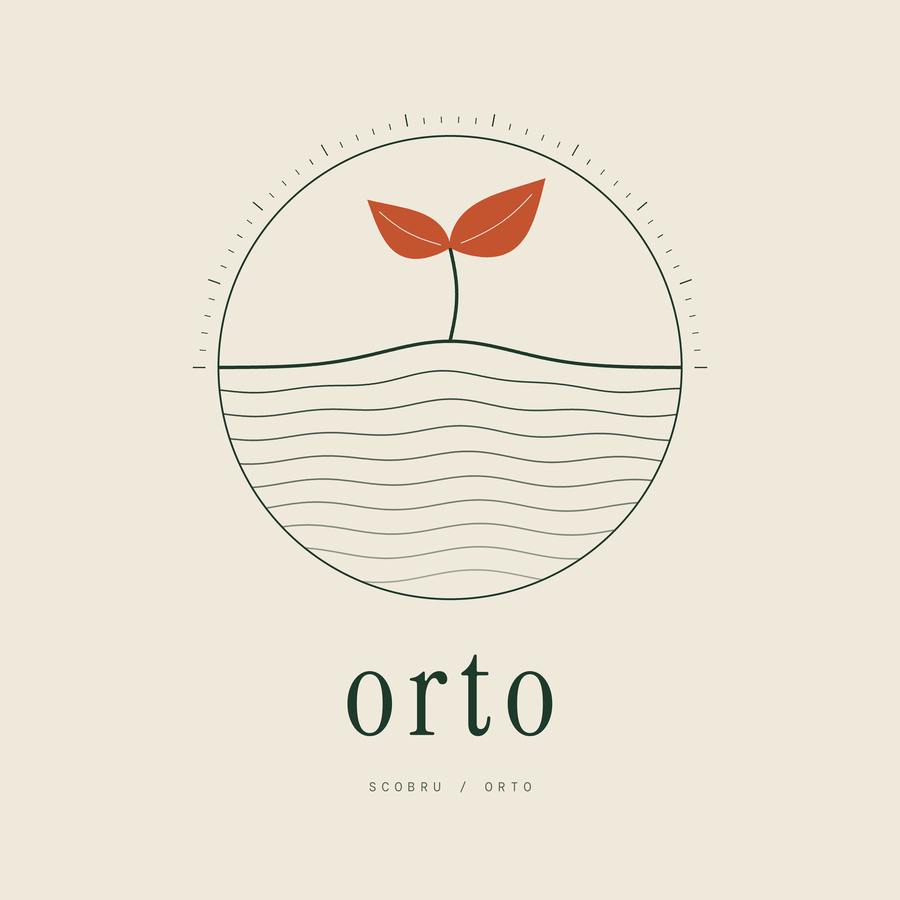

<p align="center"></p>

# Orto

*Formerly ZenOS.*

[![Buy me a coffee]](https://buymeacoffee.com/scobru)

[Buy me a coffee]: https://img.shields.io/badge/Buy%20me%20a%20coffee-scobru-FFDD00?logo=buymeacoffee&logoColor=black

Encrypted notes, calendar, tasks, bookmarks, contacts, secrets, files and a public blog, on **one small server you run yourself**: a Node script, one SQLite file and a folder of uploads. No ZEN/P2P network, no npm dependencies.

- **Server** (`server.js`): HTTP API + static hosting of the web app, SQLite via Node's built-in `node:sqlite` (Node ≥ 22.5).
- **SDK** (`orto.js`): works in Node and browsers (`fetch` + WebCrypto).
- **CLI** (`cli.js`): every app from the terminal, for scripts and AI agents.
- **MCP server** (`mcp.js`, `orto-mcp`): the same data for Claude Desktop, Claude Code and other MCP clients (see below).
- **Web app** (`web/`): served by the server itself, and also installable as a PWA.
- **Landing page** (`site/`).

## Run it

```bash
git clone https://github.com/scobru/orto.git
cd orto && npm start          # http://127.0.0.1:8787
```

One line, no clone and no Docker (needs Node ≥ 22.5; data goes in `./data`):

```bash
npx -y -p github:scobru/orto orto-server
```

Set things with env vars in front of it, e.g. `PORT=8080 ORTO_DATA=~/orto-data ORTO_ADMIN_PASS=change-me-please npx -y -p github:scobru/orto orto-server` (PowerShell: `$env:PORT=8080; npx -y -p github:scobru/orto orto-server`). It listens on `127.0.0.1` only; put HTTPS in front of it (Caddy, nginx, a tunnel) to use it from other devices.

Open the URL, type a username and password; the first time, the app offers to create the account.

**Desktop, no Node or server needed.** Download `orto-<os>.zip` from the latest [release](https://github.com/scobru/orto/releases) (`win-x64`, `darwin-arm64` / `darwin-x64`, `linux-x64` / `linux-arm64`), unzip and run `Orto.cmd` (Windows), `Orto.command` (macOS: first time right-click, Open) or `Orto.sh` (Linux). It starts a local server on `127.0.0.1:8787` and opens the browser; data lives in `%APPDATA%\\Orto`, `~/Library/Application Support/Orto` or `~/.local/share/orto` (back it up). Close the window to stop it. Built by `.github/workflows/desktop.yml` on every `v*` tag; from source: `node desktop.js`.

Docker (includes the web app, data in the `zenos-data` volume): `docker compose up -d --build`, then open http://localhost:8787. The compose build also includes the optional tag suggestions (below); `ORTO_GIST=0 docker compose up -d --build` (or `--build-arg ORTO_GIST=0`) leaves them out. Or: `docker build -t orto . && docker run -d -p 8787:8787 -v zenos-data:/data orto`.

**CapRover.** The repo has a `captain-definition`, so: create an app, enable *Persistent Directory* with path `/data`, set *Container HTTP Port* to `8787`, enable HTTPS, add the env vars of the table below (at least `ORTO_PUBLIC_URL=https://your-app.example.com`, and `ORTO_ADMIN_PASS` if you want `/admin`), then deploy from the repo (*Deploy via Github/Git*) or with `caprover deploy` from a clone. `caprover/orto.yml` is a one-click template for a private one-click-apps repo (it needs a published image). Behind CapRover's nginx the Range and big-upload notes below apply: raise *Client max body size* in the nginx config if you upload large media.

Put it behind a reverse proxy with HTTPS (Caddy, nginx) before exposing it to the internet.

| Env var | Default | |
|---|---|---|
| `PORT` / `HOST` | `8787` / `127.0.0.1` | listen address (`0.0.0.0` in Docker) |
| `ORTO_DATA` | `./data` | holds `orto.db` and `files/` — **back it up** (see below) |
| `ORTO_WEB` | `./web` | static files to serve |
| `ORTO_REGISTRATION` | `open` | `closed` once your accounts exist |
| `ORTO_MAX_UPLOAD` | 200 MB | per file, bytes |
| `ORTO_QUOTA` | 5 GB | per user, bytes |
| `ORTO_DEMO` / `ORTO_DEMO_HOURS` | off / `3` | public demo account, see below |
| `ORTO_ADMIN_PASS` | off | min 8 chars: turns on the admin panel at `/admin` (see below) |
| `ORTO_PUBLIC_URL` | from the request | base of the links in the blog's RSS feed (set it behind a proxy that does not pass `Host`) |
| `ORTO_FEEDS_PRIVATE` | off | `1` lets the feed reader fetch private/LAN addresses (refused by default) |

**AI agents.** With a shell (Claude Code, Cowork, scripts), `SKILL.md` + `cli.js` is enough. For clients without a shell (Claude Desktop, other MCP apps) there is a small MCP server over stdio, `mcp.js`. It must run **on your machine**, not in a hosted service: it holds your password and does the encryption, so the Orto server still only sees ciphertext. Tools (51): list, read, create and partially update notes, calendar events, tasks, bookmarks and contacts; links between notes, events and tasks; feeds (list, read, add, rename, mark read, OPML); blog (list, publish); files (list, read text, upload up to 5 MB, move, folders/albums/playlists); public share links (create, list, revoke); shared spaces (list, create, invite, accept, members, links, copy, remove, leave); and one `delete`. `ORTO_SPACE=<id>` points every tool at one space. The model sees whatever you let it read: you are sending that text to your AI provider.

```bash
claude mcp add orto -s user -e ORTO_SERVER=https://your-server -e ORTO_USER=you -e ORTO_PASS=... -e ORTO_MCP_READONLY=1 -- npx -y -p github:scobru/orto orto-mcp
```
`-s user` makes it available from every folder (without it, only from the folder where you ran the command). **On Windows** (not WSL) put `cmd /c` before `npx`: `-- cmd /c npx -y -p github:scobru/orto orto-mcp`. Check it with `claude mcp list` (`orto ... Connected`), then ask Claude Code to use the `note_list` tool of orto. Needs Node 22.5 or newer on that machine.

Claude Desktop (Settings, Developer, Edit Config, `claude_desktop_config.json`; restart afterwards): `"mcpServers": {"orto": {"command": "npx", "args": ["-y", "-p", "github:scobru/orto", "orto-mcp"], "env": {"ORTO_SERVER": "https://your-server", "ORTO_USER": "you", "ORTO_PASS": "..."}}}`; on Windows use `"command": "cmd"` and `"args": ["/c", "npx", "-y", "-p", "github:scobru/orto", "orto-mcp"]`. The password sits in that file in clear text. The *Add custom connector* form of claude.ai is for remote MCP servers and cannot run this one: it is local on purpose. Safer defaults: `ORTO_MCP_READONLY=1` hides every tool that writes or deletes; secrets are not exposed unless you set `ORTO_MCP_SECRETS=1` (a secret you read is sent to the model). Use a dedicated account if you want to limit what an agent can see.

**Feeds (RSS/Atom).** *Feeds* in the sidebar follows blogs and news: paste a feed or a site address (the feed is found for you), import or export OPML, read articles inside Orto and save one as a bookmark. Your list of feeds is encrypted like everything else; articles are fetched live and never stored. Browsers cannot read other sites' feeds directly, so the server fetches them for you (`/api/feed`, only for signed-in users, never to private addresses unless `ORTO_FEEDS_PRIVATE=1`): it therefore sees which feed addresses you fetch, and the sites see your server's IP. Article HTML is sanitized and images are loaded without a referrer. Your own blog has a feed too: `/blog/<username>/feed.xml` (the Blog view has an RSS link). From the CLI: `feed-add`, `feed-list`, `feed-read`, `feed-delete`, `feed-import`, `feed-export`.

**Media and big files.** *Media* in the sidebar plays music and video from your files: upload from there (or from Files), keep tracks in playlists, and the player stays on while you move around the app. Files uploaded from the web app, and from the CLI above 4 MB, are encrypted in 1 MiB chunks (AES-GCM, each chunk bound to its position and to the file), so the browser starts playing at once, seeking works, and memory stays small whatever the size; a service worker (`web/sw.js`) fetches and decrypts only the chunks the player asks for. Files uploaded the old way (single blob) still work and play after they are downloaded. The size limit per file is `ORTO_MAX_UPLOAD` (200 MB by default: raise it in the admin panel for video). A reverse proxy in front must pass `Range` requests and not buffer or cap big bodies (nginx: `client_max_body_size`, `proxy_request_buffering off`).

**Tag and emoji suggestions (optional, off by default).** `node scripts/install-gist.mjs` (already done by the Docker image unless you build it with `--build-arg ORTO_GIST=0`) installs [Gist](https://desertant.com/models/gist/) and [Emo](https://desertant.com/models/emo/) by Desert Ant Labs into `<data>/models/gist` (needs npm, once; run it again to add Emo to an older install). Then each user can switch on *Settings > Tag and emoji suggestions* and use *Suggest tags* and *Suggest emoji* (picks one for the note's title) in a note's menu, or *Suggest tags* in the bookmark editor. The models (Gist: 36 topics, 101 languages; Emo: 23 languages) run in the browser, so the text is not sent anywhere; the first use downloads about 75 MB of model files from huggingface.co. Privacy details: the code runs in a sandboxed iframe that cannot read your keys or storage, its CSP only allows this server and huggingface.co, and the SDK's own usage reporting to its vendor is switched off (and blocked by that CSP). Gist is source-available, not MIT: free below 100,000 monthly active devices, credit required, see its [license](https://license.desertant.com/1.0), same for Emo. Nothing of it is in this repo. Desert Ant has no summarization model, so there is no summary feature.


**Admin panel.** Set `ORTO_ADMIN_PASS` and open `/admin`. From the browser you can change registration, max upload and quota (saved in the database, they override the env values until you press *Back to env defaults*), see every user with their usage, sign a user out everywhere or delete them, and write a backup under `<data>/backups/`. Passwords cannot be reset (everything is end-to-end encrypted), only removed. Serve it over HTTPS.

The old `ZENOS_*` variable names, a data folder holding `zenos.db` and the `zenos-data` Docker volume all keep working after the rename.

## Web app

Notes (Markdown, tags, checklists, files and images attached from Files with the paperclip), Tasks (Kanban), Calendar, Bookmarks (Brave/Chrome/Firefox import and export), Feeds (RSS/Atom reader, OPML), Contacts (vCard), Secrets (with a password generator), Files, **Photos** (thumbnail grid of your images; upload is manual, a browser cannot back up a camera roll) and a public Blog at `/blog/<username>`, all encrypted in the browser. **Garden** draws your workspace as a vegetable patch: tasks are plants (sprouting, growing, wilting when overdue, harvested when done), upcoming events are tulips that open as they get close, recent notes bring rain and butterflies, unread feed items fall as leaves and year-old secrets are rocks. Nothing is stored for it: it is computed from your data every time, and tapping a plant opens its task. **Settings** has export / import, your public links with revoke and change password. Use *Install* / *Add to Home Screen* to get it as an app (the service worker only keeps the app itself available: your data needs the server). Contacts, Secrets, Bookmarks, Tasks and Calendar have an *Examples* button with fake entries to try things out.

The app picks its server like this: the one set with the **Server** link on the login screen (it remembers the ones you used); otherwise the site it is served from, if that runs an Orto server; otherwise `https://orto.scobrudot.dev`. To host `web/` on a static host, open it and use the **Server** link to point it at your server (tokens are sent as `Authorization` headers, not cookies, so cross-origin works). Public links (`/s/...`) only work when the server itself serves the app.

## Demo account

`ORTO_DEMO=1 npm start` (or `ORTO_DEMO=1` in your Docker environment) adds a public **demo** account (user `demo`, password `demo`) that is wiped and refilled with random fake data (notes, tasks, events, bookmarks, contacts, secrets and 8 generated photos) at start and every `ORTO_DEMO_HOURS` (default 3) hours. The login screen shows *Try the demo account*, and `https://your-server/?demo` signs straight in, so you can link visitors to it.

It is still encrypted like any account; the password is just public. For the demo user the server turns off public links, public blog posts and password change (they would be shared by everyone), and caps it at 10 MB, 1000 records and 40 files. Other accounts on the same server are not touched. A real account that already has the name `demo` with another password is never wiped (the demo stays off and says so in the log). Visitors can still edit or delete what they see; the next reset puts everything back.

## Backup, migration, sharing

- **Server backup**: `node server.js backup <folder>` writes a consistent copy of the database and the uploads (safe while the server runs). Restore: stop the server and use that folder as `ORTO_DATA`.
- **Your own export**: `node cli.js export --out me.json` (or **Settings > Export** in the web app) saves everything decrypted; `node cli.js import --file me.json` loads it into any account on any server. That is also how you move to another server. The file is plain text: keep it safe.
- **Public links**: `node cli.js share-note --soul <soul>` / `share-file --id <id>` (or **Share** in the web app) give `https://<server>/s/<id>#<key>`. The item is encrypted with a fresh key that lives only in the `#fragment`, so the server never sees it; anyone with the link can read it. `share-revoke` deletes it.
- **Change password**: `node cli.js password-change --new '…'` (or Settings). It re-encrypts everything, then signs out your other sessions. Export first.

## Freenet: Web dApp & P2P Sync

Orto can run as a **native decentralized web dApp** published directly onto [Freenet](https://freenet.org), as well as provide P2P replication between your devices.

### 1. Web dApp on Freenet
The frontend can be deployed directly as a sovereign web contract:
```bash
npm run freenet:publish   # updates contract web assets via fdev
```
- **Sovereign Identity**: No central server, passwords, or registration. Sign in with 1-click Ed25519 key generation or **Viso SSO**.
- **Sandboxed & Zero-Server**: Runs in Freenet's sandboxed contract environment (`http://127.0.0.1:7509/v1/contract/web/<key>/`).
- **Replicated on Freenet**: notes, calendar, tasks, bookmarks, contacts, secrets, feeds and file lists are signed and stored in your vault contract (`contracts/vault`, `src-freenet/vault.ts`), so signing in with the same username and password on another device finds the same data. Files and media go to content-addressed chunk contracts. Shared spaces stay on the device for now.
- **Resilient Offline & Sandbox Persistence**: Notes, settings, and credentials persist across browser refreshes through a multi-tier fallback (`localStorage` with an encrypted `window.name` session mirror) adapted for sandboxed iframes.
- **Session Locking & Logout**: Lock your session cleanly in-place. Clears in-memory keys, scrubs URL authentication parameters (`?viso=`, `?pk=`) and hashes (`#sk=`), and offers 1-click key backup or identity forgetting ("Dimentica").
- **On-Device AI**: Local tag and emoji suggestions using Desert Ant Labs models run entirely client-side inside a sandboxed frame with zero cloud telemetry.
- **P2P Shared Spaces**: Spaces operate peer-to-peer using ECDH public keys without central servers.

### 2. Server-side Freenet Sync (optional)
When self-hosting the Node.js server, Freenet can also be used as a P2P replication channel between your own servers:
```bash
node server.js freenet-identity --new --show-secret   # a new Ed25519 identity: back up the 64 hex chars
node server.js freenet-identity --import <64 hex>     # on another device: same key = same vault
node server.js freenet-sync --user <name>             # pull what others wrote, push what changed here
```

The identity file is `<data>/freenet-identity.json` (keep it private). The vault contract is `contracts/vault` (Rust, `cargo test`; package with `fdev build` from that folder, output in `build/freenet/`; `ORTO_VAULT_WASM` overrides the path). Every record is signed on its own with the identity key (or a Viso delegation, supported by the contract), merged last-write-wins.

## Shared spaces

A **space** is a shared folder: notes, tasks, calendar, bookmarks, contacts, secrets, files, photos and media, together, live. Open **Shared spaces** at the top of the sidebar of the web app (or use `space-*` in the CLI, `openSpace()` in the SDK).

- **On Freenet (P2P)**:
  - **Public Key Identity**: Your ECDH (P-256) public key and fingerprint are displayed right in the modal.
  - **Direct Public Key Invites**: Enter the recipient's Public Key (`wrapFor`). The space AES key is sealed for their public key: `#join=dir.<payload>` — only the recipient's private key can open it.
  - **Capability Links**: Create fast shareable links (`#join=cap.<token>.<payload>`) with editor or viewer roles.
  - **Segregated Vault**: Space notes and records are partitioned under `sp:<spaceId>:`, isolated from your personal vault.
- **On Centralized Server**:
  - **Invite by username**: Registered users see invitations in their sidebar badge.
  - **Invite links**: `https://<server>/app#join=...` with a role. Revoke at any time.
- **Copy** a note or a file into a space (note menu, Files list; `space-copy` in the CLI) or back to Personal.
- CLI and MCP: add `--space <id>` (or `ORTO_SPACE=<id>`) to any command to work inside a space.

Still end-to-end encrypted: each space has its own random AES key. Every member holds it wrapped (ECDH P-256) for their own public key, and invite links carry it in the `#fragment`, so the server/network never sees it. Your private key is sealed with your own key. Removing a member **changes the space key** and re-encrypts the space, so what they kept cannot open anything written afterwards. Notes are last-write-wins; storage of a space is counted for the space, not per member.

## How it stays private

Your login derives two independent keys with PBKDF2 (210k rounds): an **AES-GCM key** that never leaves the client, and an **auth secret** the server stores only as a hash. Notes, events, tasks, bookmarks, contacts, secrets, file contents *and* file names are encrypted before upload; the server (and anyone with the SQLite file) sees ciphertext, usernames, record ids and timestamps. The blog is the one public part.

Forget the password and the data is gone: there is no recovery, by design. Usernames are case-insensitive; the password is case-sensitive.

## CLI

```bash
export ORTO_SERVER=http://127.0.0.1:8787     # or --server; default https://orto.scobrudot.dev
node cli.js register --user alice --pass 'long passphrase'
node cli.js vault-write --user alice --pass '…' --title "Hello" --body "First note"
node cli.js vault-read  --user alice --pass '…'
node cli.js file-upload --user alice --pass '…' --file photo.png --folder Docs/2026 --album Trip
node cli.js file-list --folder Docs --table      # file-move --id <id> --album Pets to reorganize
node cli.js blog-publish --user alice --pass '…' --title Hi --content "Public post"
node cli.js blog-read --alias alice            # public, no login
node cli.js --help                             # every command
```

The CLI and SDK talk to `https://orto.scobrudot.dev` unless you set `ORTO_SERVER` / `--server` / `{ server }`.

Put `ORTO_USER` / `ORTO_PASS` in `.env` (see `.env.example`) to drop the flags.

## SDK

```js
import Orto from './orto.js';
const os = new Orto();   // default server: https://orto.scobrudot.dev
await os.login('alice', 'long passphrase', { create: true }); // create only the first time
await os.writeVaultNote({ title: 'Hello', body: 'First note' });
await os.writeTask({ title: 'Ship it', priority: 'high' });
const up = await os.uploadFile(new Uint8Array([1, 2, 3]), 'tiny.bin');      // encrypted client-side
const bytes = await os.downloadFile(up.id);
os.onTask((task, soul, deleted) => console.log(task, deleted));             // live updates (SSE)
```

Collections: `Vault`, `CalendarEvent`, `Task`, `Bookmark`, `Contact`, `Secret` each have `write*`, `get*`, `read*`, `delete*`, `on*`; plus `uploadFile/listFiles/downloadFile/deleteFile` (and `uploadFileChunked`, `readFileRange` for big files and streaming; `moveFile`, `fileGroups`, `addFileGroup`, `renameFileGroup` for folders, albums and playlists), `shareNote/shareFile/listShares/unshare` (+ `readShare(link)`), `exportAll/importAll/changePassword` and `publishBlogPost/readBlogPosts/getBlogPost/deleteBlogPost/onPost`. See [llm.txt](llm.txt).

## HTTP API

All JSON. `Authorization: Bearer <token>` from `POST /api/login` or `/api/register` (`{name, auth}`).

| | |
|---|---|
| `GET /api/c/:collection` | list records |
| `GET/PUT/DELETE /api/c/:collection/:soul` | one record (PUT body is stored as-is; clients send `{data: <ciphertext>}`) |
| `GET /api/events` | server-sent events for your collections |
| `POST /api/files` (raw body), `GET/PUT/DELETE /api/files/:id` | blobs (PUT replaces in place) |
| `POST /api/s` (`{data}` JSON or raw bytes), `DELETE /api/s/:id` | create / revoke a public share |
| `GET/POST /api/sp`, `/api/sp/:id/{members,links,accept}`, `/api/sp/:id/c/...`, `/api/sp/:id/files...` | shared spaces (see [llm.txt](llm.txt)) |
| `GET /api/s/:id` | public ciphertext of a share, no auth (`/s/:id#key` is the page) |
| `POST /api/password` (`{auth, newAuth}`; `check: true` = dry run) | swap the login secret after re-encrypting |
| `GET /api/config` | `{registration, maxUpload, demo?}` (no auth) |
| `GET /api/u/:name`, `GET /api/u/:name/posts` | public profile and blog, no auth |
| `GET /blog/:name` | public blog page (e.g. https://orto.scobrudot.dev/blog/scobru) |

## Tests

`npm test` executes the complete test suite across both SQLite and Freenet runtimes:

1. **Server & SQLite tests (`test.js`)**: Starts a throwaway server on a temp SQLite file and tests the entire SDK: client-side AES-GCM encryption at rest, isolation between users, chunked file streaming, live SSE events, public share links, encrypted export/import, password rotation, and server backups.
2. **Freenet integration tests (`test-freenet.js`)**: Tests the decentralized browser runtime in simulated zero-server conditions:
   - Sovereign Ed25519 identity generation and login key derivation.
   - Encrypted note creation, listing, and round-trip verification (`writeVaultNote` / `readVaultNotes`).
   - Real-time event listener dispatching (`onVaultNote`).
   - Resilient persistence across page reloads using the encrypted `window.name` session mirror.
   - P2P Shared Spaces with ECDH P-256 sealed invites and capability links (`#join=cap...`).
   - Isolated `safeStore` state avoiding clobbering between notes, UI preferences, and AI settings.

## Coming from ZenOS or the ZEN version

Nothing to migrate from ZenOS: same data, same logins (the key derivation keeps its original `zenos:v1:` salt on purpose). Just pull, restart, and keep using your data folder.

The oldest build kept data in the ZEN graph under a secp256k1 identity; this one uses a different identity and storage, so the two do not share data. To move over: export bookmarks / contacts (HTML / vCard) from the old app and import them here; copy notes by hand or with a script using both SDKs. 

## License

MIT
